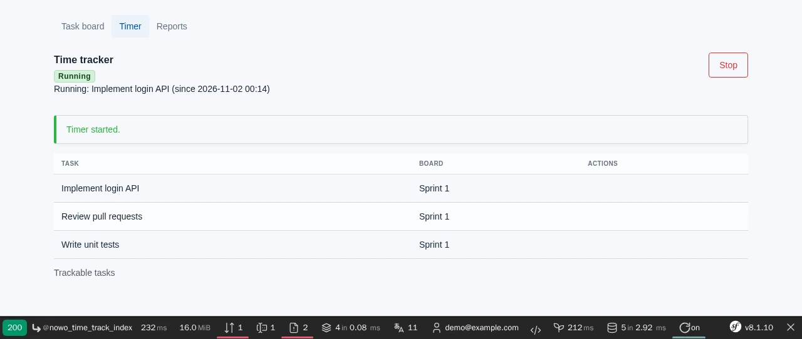
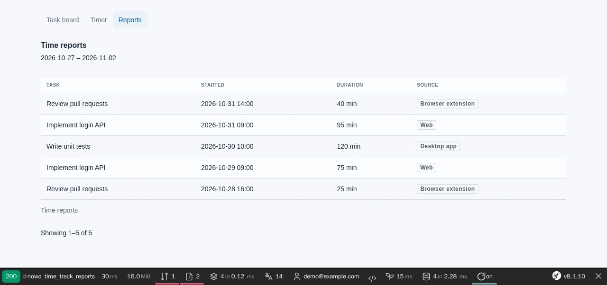
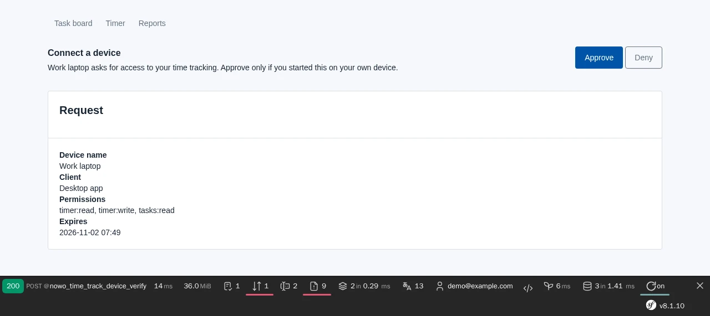

# TimeTrack Bundle

[](https://github.com/nowo-tech/TimeTrackBundle/actions/workflows/ci.yml) [](https://packagist.org/packages/nowo-tech/time-track-bundle) [](https://packagist.org/packages/nowo-tech/time-track-bundle) [](LICENSE) [](https://php.net) [](https://symfony.com) [](https://github.com/nowo-tech/TimeTrackBundle) [](#tests-and-coverage)

> ⭐ **Found this useful?** Give it a **star** on [GitHub](https://github.com/nowo-tech/TimeTrackBundle) so more developers can find it.

Symfony bundle for **personal and team time tracking**: one active timer per user, task references via `TaskBoardBundle`, browser extension API, and Tauri desktop agent API.


This bundle is **FrankenPHP worker mode friendly**, also with the kernel kept alive and not reset between requests
(`FRANKENPHP_RESET_KERNEL=false`): see [FRANKENPHP-WORKER-AUDIT.md](docs/FRANKENPHP-WORKER-AUDIT.md). It works out of the box in a
standard Symfony project, and a DDD / hexagonal host can use it opt-in ([USAGE.md](docs/USAGE.md#using-it-from-a-ddd--hexagonal-application)).

## Features

- Web UI at `/tools/time-track` (timer + paginated reports)
- Stateless client API for the browser extension and the desktop app (`Bearer` session tokens linked to host credentials, scopes, per-request credential and task checks, device flow, rate limits, audit events) — [reference](docs/CLIENT-API.md)
- Single active timer per user (409 on conflict)
- Teams and managers v1 via `TeamContextProviderInterface`
- Task integration via `TaskProviderInterface` (designed for `nowo-tech/task-board-bundle`)
- Symfony events for timer start/stop and entry ACL
- **Ops:** `nowo:time-track:client-tokens:purge` for expired browser/desktop tokens
- **Working time and timesheets (1.13, opt-in)**: hours balance and overtime from a host working calendar and worked
  time (register or task time, labelled), an append-only balance ledger, weekly timesheets with submit / approve /
  reject and an audited reopen, a hard period lock on every write path, SHA-256 chained audit trails, tenant scopes,
  the workday / balance / timesheet client API and configurable Twig components ([WORKING-TIME.md](docs/WORKING-TIME.md)).
- **Calendar suggestions, manual entries and meetings (1.14, opt-in)**: read-only Google / Microsoft 365 adapters of the
  primary calendar (host-held tokens, minimal fields), task-key matching and literal user rules, dailies grouped per
  week, suggestions accepted into `calendar` entries (lock and overlap aware), `POST entries`, `resolve-keys` for the
  desktop's local mode, and `GET me/meetings` over a host meeting read model with strict privacy filters
  ([CLIENT-API](docs/CLIENT-API.md#changes-in-114-calendar-suggestions-manual-entries), [MEETINGS.md](docs/MEETINGS.md)).
- **Billable entries (1.21)**: an audited `billable` setter under the edit and period-lock rules, a host default for
  new entries and `PATCH entries/{id}` on the client API ([USAGE](docs/USAGE.md#billable-entries-121)).

## Installation

```bash
composer require nowo-tech/time-track-bundle
```

```yaml
# config/packages/nowo_time_track.yaml
nowo_time_track:
    user_class: App\Entity\User
    clients:
        enabled: true
```

See [Installation](docs/INSTALLATION.md).

## Demo

Integrated demo with **TaskBoardBundle** (kanban + timer):

```bash
make -C demo up-symfony8
# Timer UI: http://localhost:8024/tools/time-track
# Demo started at: http://localhost:8024
```

- Timer UI: `/tools/time-track`
- Task board: `/tools/task-board`
- Login: `demo@example.com` / `demo`

<table>
  <tr>
    <td width="50%">
      
    </td>
    <td width="50%">
      
    </td>
  </tr>
  <tr>
    <td width="50%">
      
    </td>
    <td width="50%"></td>
  </tr>
</table>

End-to-end tests (Playwright, REQ-DEMO-013) and the screenshots:

```bash
make -C demo/symfony8 test-e2e           # timer page, start / stop, reports
make -C demo/symfony8 demo-screenshots   # refreshes docs/images/demo/*.webp
```

With TaskBoard only, configure `nowo_time_track.task_provider: nowo_task_board.task_provider` — see [TaskBoard integration](docs/TASK-BOARD-INTEGRATION.md).

## Documentation

- [Installation](docs/INSTALLATION.md)
- [Configuration](docs/CONFIGURATION.md)
- [Usage](docs/USAGE.md)
- [Templates (UiKit page contract)](docs/TEMPLATES.md)
- [Contributing](docs/CONTRIBUTING.md)
- [Code of Conduct](CODE_OF_CONDUCT.md)
- [Changelog](docs/CHANGELOG.md)
- [Upgrading](docs/UPGRADING.md)
- [Release](docs/RELEASE.md)
- [Security](docs/SECURITY.md)
- [Engram](docs/ENGRAM.md)
- [Spec-driven development](docs/SPEC-DRIVEN-DEVELOPMENT.md)
- [GitHub Spec Kit](docs/SPEC-KIT.md)

### Additional documentation

- [Demo with FrankenPHP](docs/DEMO-FRANKENPHP.md) (includes worker mode)
- [GitHub Actions CI requirements](docs/GITHUB_CI.md)
- [PSR evaluation (REQ-CS-007)](docs/PSR.md)
- [Client API reference](docs/CLIENT-API.md)
- [Working time, balance and timesheets](docs/WORKING-TIME.md)
- [Meetings API (host guide)](docs/MEETINGS.md)
- [Browser extension](docs/BROWSER-EXTENSION.md)
- [Desktop agent (Tauri)](docs/DESKTOP-AGENT.md) — `desktop/` tray app
- [TaskBoard integration](docs/TASK-BOARD-INTEGRATION.md)
- [Roadmap](docs/ROADMAP.md)

## Tests and coverage

```bash
make test
make test-coverage
make release-check
```

- **PHP:** 100% lines — controllers, Doctrine repositories and listeners included (functional tests on in-memory SQLite, `tests/Functional/`); only pure interfaces are excluded (`phpunit.xml.dist`)
- **TS/JS:** N/A (desktop agent lives in `desktop/`, outside bundle PHP coverage)
- **Python:** N/A

## License

MIT — see [LICENSE](LICENSE).
